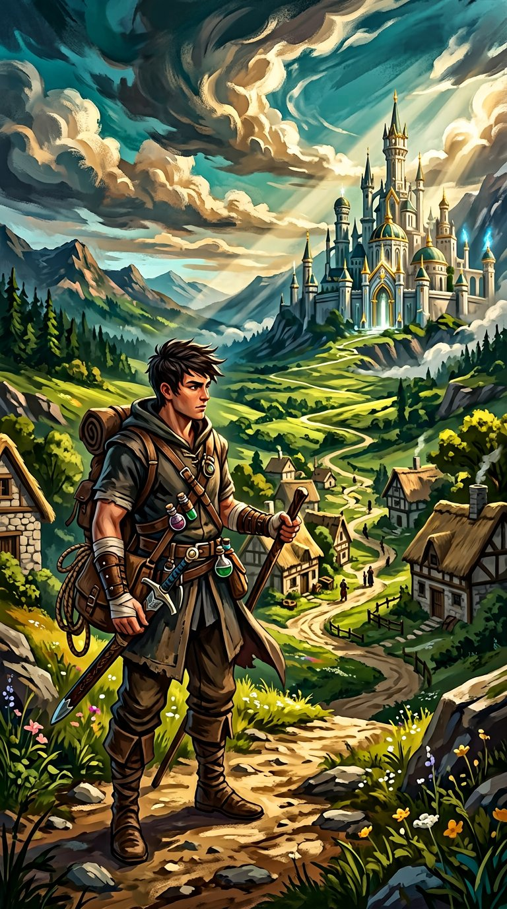

# A Academia do Zero



**RPG de ação em terceira pessoa, de mundo aberto, sobre um rapaz sem magia num mundo que adora magia.**
Um Vazio que vale mais pelos dois braços do que os magos valem pelos Núcleos.

> Estado: **Vertical Slice v0.2** — v0.1 jogável + modelos e animações reais (KayKit, CC0), ver [o que mudou na v0.2](#o-que-mudou-na-v02).

---

## Sobre o jogo

Num mundo onde governos, exércitos, escolas, hospitais e transportes dependem
da magia, nasceu **Kael Noro** — sem Núcleo Arcano, sem feitiços, sem valor
aos olhos da sociedade. Criado na aldeia de **Noro**, treinou o corpo até se
tornar algo que o mundo mágico diz não existir: alguém que enfrenta magos
de igual para igual, à força de músculo, técnica e uma Corrente de Âncora.

O documento de design completo (mundo de Arkanor, as seis disciplinas mágicas,
as faculdades, os finais e tudo o resto) está em [`docs/GDD.md`](docs/GDD.md).
O caminho até à v1.0 está em [`docs/ROADMAP.md`](docs/ROADMAP.md).

## Como correr

1. Instala o **Godot Engine 4.2 ou superior** (gratuito, de [godotengine.org](https://godotengine.org) — a versão padrão, *não* a Mono/.NET).
2. Abre o Godot → **Importar/Scan** → seleciona a pasta do repositório (ou o ficheiro `project.godot`).
3. Carrega **F5** (ou `godot --path .` no terminal).
4. O jogo abre no ecrã de título. Em nova campanha: **Novo Jogo**.

Não é preciso instalar dependências — os modelos 3D (CC0, KayKit) estão incluídos
no repositório em `assets/models/`, e os efeitos sonoros são sintetizados em
`assets/audio/`. A key art do título foi gerada por IA (`assets/art/key_art.jpg`).
Detalhes e licenças: [`docs/ASSETS.md`](docs/ASSETS.md).

## Controlos

| Tecla | Ação |
|---|---|
| W/A/S/D ou Setas | Mover |
| Rato | Câmara (clicar no jogo para focar o rato) |
| Botão esquerdo | Ataque leve (combo de 3) |
| Botão direito | Ataque pesado |
| Espaço | Esquiva (curta invulnerabilidade) |
| Shift | Correr |
| Q (segurar) | Bloquear |
| Q (no instante certo) | **Parry perfeito** (quebra postura, enche Ruptura) |
| E | Interagir / **Corrente de Âncora** (puxa e interrompe feitiços) |
| R | Beber poção (+45 vida) |
| F | **Estado de Ruptura** (quando a barra está cheia) |
| Tab | Fixar / largar alvo |
| Esc | Menu de pausa (salvar/carregar, atributos, Sistema, a Decisão) |

## O que mudou na v0.2

Evolução de qualidade sobre a v0.1 (o conteúdo de jogo é o mesmo; o mundo e o combate ganharam vida):

- **Personagens por modelos 3D esqueléticos** (KayKit Adventures, CC0): Kael (Rogue Hooded tingido
  carvão, a condizer com a referência de personagem em `assets/art/kael_reference.jpg`),
  inimigos humanoides (Salteador = Barbarian tintada, Mago de Cinza = Mage tintada,
  Guardião = Barbarian gigante em pedra) e os 5 NPCs — cada um com **Idle/Walking/Running**,
  **ataques**, **hit**, **block**, **dodge** e **morte** animado. O lobo mantém-se procedural.
- **Mundo com modelos KayKit Medieval Hexagon** (CC0): casas, taverna, capela, forja, mercado,
  poço, castelos academias, torres e muralha do portão, árvores, rochas, montanhas e props
  (barris, caixas, sacos, escadas, tendas, bandeiras, alvos de treino...). Estruturas de colisão de jogo
  são independentes dos modelos.
- **Canal de conjuração do Mago de Cinza**: feitiço é telegrafado (Spellcast_Raise → disparo)
  e pode ser **interrompido pela Corrente de Âncora** — a mecânica anti-magia passou a ter um
  janela real de contra-jogo.
- **Game feel**: screen shake (impacto, parry, dano sofrido), partículas de impacto,
  números de dano flutuantes e *hit-flash* branco nos modelos.
- **Correções**: identificadores não declarados nos fallbacks procedurais (quebrariam a
  compilação do script de inimigos), reset de estado de morte (Kael volta a pôr-se de pé após
  renascer), validação cruzada de todos os caminhos de modelos contra o disco.

## O que está pronto na v0.1

Implementação do escopo do "Capítulo 35 — Escopo Realista" do documento de design:

- **Mundo aberto pequeno mas vivo**: Vila de Noro (praça, forja, poço, mercado),
  a Estrada Imperial pela **Floresta Baixa**, o **Portão da Academia** com
  Liora Venn e o **Mestre Dario Vale**, e a **arena** do Guardião da Prova.
- **Combate físico completo**: ataques leves/pesados com combo, esquiva com
  i-frames, bloqueio, **parry**, barra de **postura** nos inimigos, ataques
  aéreos... (quase — ver [limitações](#limitações-conhecidas)), e a
  **Corrente de Âncora** como ferramenta anti-magia.
- **Estado de Ruptura**: meter de tensão que carrega com parries, golpes e
  dano — ativa fúria temporária com F.
- **8 atributos** com progressão por XP e pontos para gastar
  (Força, Velocidade, Reflexos, Resistência, Fôlego, Técnica, Perceção, Adaptação).
- **4 inimigos originais**: Lobo de Cinza, Salteador de Ruína, Mago de Cinza
  (projéteis arcanos) e o chefe **Guardião da Prova** (golpe de área
  telegrafado).
- **Missão principal** completa (falar com a mãe → ferreiro → floresta →
  Liora → prova → Guardião → **decisão final com 3 finais possíveis**),
  **2 missões secundárias** (Lobos da Estrada, Luz para as Lâmpadas).
- **O Sistema (Sala Branca)**: a dimensão secreta de treino, com boneco de
  treino, legendas misteriosas e **avaliação de desempenho** (golpes,
  precisão, dano sofrido) que recompensa com pontos de atributo (máx. 5).
- **Save/load** em JSON (menu de pausa), morte estilo Dark Souls leve
  (perde 10% dos marcos, acorda na vila).
- Menus completos: título com key art, pausa, atributos, controlos,
  HUD com objetivo rastreado, notificações, fixar-alvo com barra de postura.
- **Acessibilidade**: legendas de diálogo, alto contraste nos elementos,
  barras de vida/fôlego/postura/ruptura separadas, texto ajustável pela janela.

## Limitações conhecidas

- **O código foi validado estruturalmente** (syntax via `gdparse`, referências
  `res://`, `.tscn`/`project.godot`), mas **não foi executado numa máquina com a
  engine dentro deste ambiente** — alguns bugs visuais/de jogabilidade são
  esperados na primeira execução. Reporta problemas (abre uma issue) e corrige-se.
- Arte 3D agora com **modelos KayKit (CC0)**, estilizados e low-poly — coerente e
  consistente, mas ainda "de pack"; falta: direção de arte própria, VFX elaborados,
  sombras/iluminação mais ricas e afinação fina de escala/posicionamento em execução
  (os colisores são invisíveis, por isso o jogo funciona mesmo se um modelo estiver
  um pouco desalinhado).
- Modelos assumem **+Z como frente** e escala estimada por olho; se algo aparecer
  virado ao contrário ou desproporcional, os ajustes estão em
  `src/visuals/model_factory.gd` (`MODEL_FACING_OFFSET`) e na escala por modelo
  em `world_builder.gd`.
- O áudio são **bleeps sintetizados** (placeholder honesto, fica melhor com uma
  verdadeira sessão de sound design).
- Mundo **fixo em um vale**: sem streaming, sem mudança de época/dia, sem
  persistência de NPCs, sem respawn de inimigos fora do Vale.
- Sem conjuradores a cooperar taticamente, sem montarias, sem economia
  completa, sem relações/romances — tudo isso está no GDD e no roadmap.
- Death during boss resets you at the arena entrance with the guardian's
  current HP (sem reset total).

## Estrutura do repositório

```
project.godot            # configuração do projeto Godot 4
scenes/                  # cenas (.tscn): título, principal, jogador, inimigos...
src/
  core/                  # estado global, input map, orquestração da cena
  player/                # Kael: movimento, combate, câmara
  enemies/               # IA e tipos de inimigos + projéteis
  world/                 # construção do Vale de Noro (modelos + primitivos)
  interaction/           # NPCs e Fibras de Ruína
  system/                # a Sala Branca (Sistema) e bonecos de treino
  ui/                    # título, HUD, pausa, atributos, diálogos, decisão
  visuals/               # fábrica de modelos/animações + efeitos (shake, bursts)
assets/models/           # modelos CC0 (KayKit): characters/ e env/ — ver docs/ASSETS.md
assets/art/              # key art (título) + referência de personagem (kael_reference.jpg)
assets/audio/            # SFX sintetizados (tools/synth_audio.py)
tools/                   # validate.py (checagens) e synth_audio.py
docs/                    # GDD.md, ROADMAP.md, ASSETS.md, licenses/
```

## Ferramentas de qualidade

```bash
# validar estrutura do projeto (sem a engine):
python3 tools/validate.py

# regenerar SFX (WAV 16-bit, 22050 Hz):
python3 tools/synth_audio.py
```

## Licença e autoria

O mundo, a história e os personagens pertencem ao projeto. Documento de
design original em `docs/GDD.md`.

Modelos 3D: **KayKit** (Kay Lousberg), licença **CC0** — ver
[`docs/ASSETS.md`](docs/ASSETS.md) e `docs/licenses/`.
Feito com Godot Engine (MIT).
